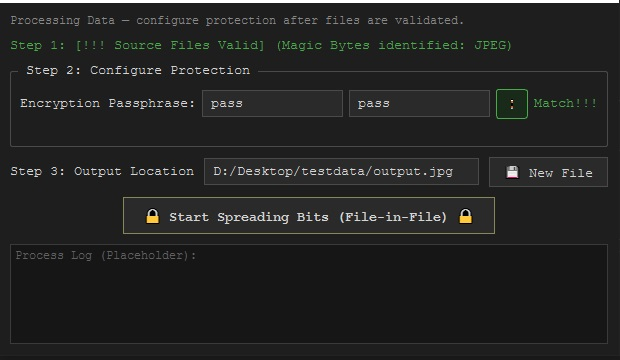
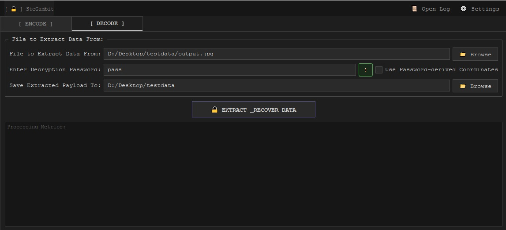
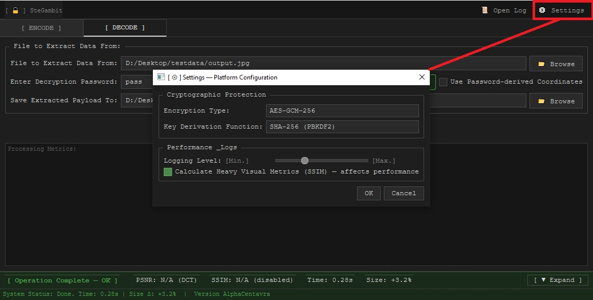

# 🔒 SteGambit


**SteGambit** - это кроссплатформенный инструмент для безопасного сокрытия файлов внутри других файлов - **стеганография "File-in-File"** с использованием криптографической защиты. Проект реализует продвинутые алгоритмы внедрения данных в изображения (PNG, JPEG) и аудио (WAV), обеспечивая высокую визуальную и статистическую незаметность.

## 🌟 Ключевые возможности

* **Мультиформатность:** Поддержка `PNG` и `WAV` (пространственное/временное LSB-внедрение) и `JPEG` (частотное JSteg-внедрение в DCT-коэффициенты).
* **Content-Aware Spreading (LSB):** Встроенный детектор границ (Edge Detection) анализирует градиенты изображения и автоматически избегает "гладких" областей, внедряя скрытые данные только в шумные участки для защиты от визуальных атак.
* **Строгая криптография (AEAD):** Перед внедрением любой файл шифруется алгоритмом **AES-GCM-256**. Ключи генерируются на основе пароля с использованием **PBKDF2 (SHA-256)** с уникальной солью.
* **Детерминированный хаос (PRNG):** Координаты внедрения псевдослучайно перемешиваются. Сидом (seed) для генератора выступает криптографический хеш пароля, что делает невозможным извлечение (или даже обнаружение) данных без знания исходной секретной фразы.
* **Встроенная аналитика:** Автоматический расчет метрик качества: **PSNR**, **SSIM** (опционально) и процента отклонения размера файла.

---

## 📸 Интерфейс // User Guide

SteGambit спроектирован по принципу "Сложно внутри — просто снаружи". Главное окно предоставляет быстрый доступ к процессам кодирования и декодирования.

### 1. Оценка совместимости и скрытие (ENCODE PANEL)

1. Выберите файл-контейнер (**Carrier File**).
2. Выберите файл для сокрытия (**Payload File**).
3. Нажмите `Check Compatibility`. Ядро математически оценит ёмкость контейнера: для PNG анализируется количество edge-пикселей, для JPEG — наличие доступных среднечастотных AC-коэффициентов.
4. Если статус `FITS`, нажмите `HIDE DATA`.
5. В открывшемся диалоге введите пароль и выберите путь сохранения.



### 2. Извлечение данных (DECODE PANEL)

1. Выберите зараженный (stego) файл.
2. Укажите папку для выгрузки.
3. Введите пароль, использованный при сокрытии.
4. Нажмите `Extract Data`. Система проверит Magic Bytes зашифрованного фрейма и целостность тега аутентификации MAC (AES-GCM), после чего восстановит исходный файл с оригинальным расширением.

### 3. Конфигурация и Метрики качества
В меню `⚙ Settings` можно отключить тяжелые визуальные метрики (SSIM) для ускорения работы или управлять уровнем логирования. А после каждого внедрения выводится панель `AnalyticsAnalyzer`:


---

## 🛠 Техническая архитектура (Under the Hood)

SteGambit построен по принципу **Clean Architecture** с чёткой границей между слоями:

```text
┌─────────────────────────────────────────────────────────┐
│                    GUI Layer (PyQt6)                    │
│  MainWindow → EncodePanel / DecodePanel / SettingsDlg   │
└─────────────────────────────────────────────────────────┘
                             │
                             │ StegoTaskRequest (DTO)
                             ▼
┌─────────────────────────────────────────────────────────┐
│                  Async Layer (QThread)                  │
│  StegoWorker — изолирует тяжёлые операции от UI-потока  │
└─────────────────────────────────────────────────────────┘
                             │
                             ▼
┌─────────────────────────────────────────────────────────┐
│                 Service Layer (Facade)                  │
│ StegoService — оркестрация: validate → crypto →         │
│ spread → embed → save → metrics                         │
└─────────────────────────────────────────────────────────┘
                             │
       ┌─────────────────────┼─────────────────────┐
       ▼                     ▼                     ▼
┌──────────────┐     ┌──────────────┐     ┌──────────────┐
│ CryptoEngine │     │   Spreader   │     │  Processor   │
│ (AES-GCM-256)│     │ (Smart/DCT)  │     │  (LSB/DCT)   │
└──────────────┘     └──────────────┘     └──────────────┘
       │                     │                     │
       └─────────────────────┼─────────────────────┘
                             ▼
                     ┌──────────────┐
                     │  Format I/O  │
                     │ PNG/WAV/JPEG │
                     └──────────────┘
```

GUI **не знает** про `numpy`, `AES` или `DCT-коэффициенты`. Service-слой **не знает** про `QtWidgets`. Связь — через DTO (`StegoTaskRequest` / `StegoResponse`).

### Криптографический фрейм

Перед внедрением payload оборачивается в `CryptoFrame` — самоописываемый бинарный блок:

```text
┌────────┬───────┬──────────┬───────────┬─────────┬──────────────────────┐
│ MAGIC  │ FLAGS │   SALT   │   NONCE   │  LENGTH │      CIPHERTEXT      │
│ 4 byte │ 1 byte│ 16 bytes │  12 bytes │ 8 bytes │      + GCM-TAG       │
└────────┴───────┴──────────┴───────────┴─────────┴──────────────────────┘
  "STGB"   v1.0     random      random    big-end       AES-GCM-256
```

- **MAGIC** — сигнатура `STGB`. При extract проверяется первой: если не совпала — либо пароль неверный, либо файл не содержит payload.
- **SALT** — случайные 128 бит (16 байт). Подаются в PBKDF2 вместе с паролем — гарантирует, что один и тот же пароль на двух разных стего-файлах даёт **разные** AES-ключи.
- **NONCE** — IV для AES-GCM (12 байт, требование стандарта NIST SP 800-38D).
- **LENGTH** — длина ciphertext в байтах. Позволяет читать ровно столько бит при extract, не больше.
- **CIPHERTEXT + GCM-TAG** — зашифрованный payload + 16-байтовый authentication tag. Любое изменение даже одного бита ciphertext'а приводит к ошибке `InvalidTag` при decrypt — это и есть детектор тампера.

### LSB Spreading (PNG/WAV)

Наивный LSB пишет биты в первые N пикселей подряд — это палится статистическим χ²-тестом за миллисекунды. **SmartSpreader** делает три вещи:

1. **Edge detection** — оператор Собеля по grayscale-проекции, отбрасывает гладкие области (где LSB-шум виден глазу).
2. **Pool pruning** — фильтрует кандидатов: остаются только пиксели с высоким градиентом.
3. **Password-seeded shuffle** — пул перемешивается перестановкой, сидированной от `SHA-256(password)`. Без пароля координаты невосстановимы.

Результат: payload разбросан по «шумным» зонам контейнера в детерминированном, но криптографически непредсказуемом порядке.

### DCT Spreading (JPEG)

Для JPEG пространственные пиксели бесполезны — повторное сжатие уничтожит изменения. **DctProcessor** работает с **квантованными DCT-коэффициентами** напрямую (без re-encode):

1. Через `jpegio` извлекаются `coef_arrays[0]` — Y-канал блоков 8×8.
2. В каждом блоке отбираются **среднечастотные AC** (zigzag 1..27): DC не трогаем (вызовет «шахматные» артефакты), высокие частоты — почти всегда нули, их модификация сломает Хаффман-сжатие.
3. Из пула исключаются значения `{-2, -1, 0, 1}` — их LSB-модификация либо меняет знак (сломает декодер), либо обнуляет коэффициент (сломает пул при extract).
4. Перестановка — та же `password-seeded shuffle`.

Получаем JSteg-подобный пайплайн с расширенным фильтром, устойчивый к re-save в большинстве просмотрщиков.

### Производительность

- **NumPy-векторизация:** все битовые операции (`unpackbits` / `packbits` / маски `& ~1 | bit`) выполняются над целыми массивами без Python-циклов.
- **Async UI:** все тяжёлые операции уходят в `StegoWorker(QThread)` — GUI не подмерзает даже на 68 МБ WAV.
- **Опциональный SSIM:** psychovisual-метрика отключаема в настройках (на 2 МБ PNG экономит ~1.5 с).

Подробные UML/C4-диаграммы и Architectural Decision Records (ADR) доступны в папке `docs/`.


---

## ⚙️ Сборка и установка (Build & Run)

### Требования

- **Python 3.12+**
- **OS:** Windows 10/11, macOS 12+, Linux (Ubuntu 22.04+)
- ~500 МБ свободного места на диске (с учётом venv + зависимостей)

### Вариант 1 — Использовать готовый .exe (для пользователей Windows)

Скачайте последний релиз из раздела **Releases** репозитория. Архив содержит:

```text
SteGambit/
├── SteGambit.exe  ← запускаемый файл
├── _internal/     ← runtime-зависимости
└── README.txt
```

Просто запустите `SteGambit.exe` — установка не требуется. Все настройки хранятся в памяти приложения (не пишутся в реестр Windows).

### Вариант 2 — Запуск из исходников (для разработчиков)

```bash
# 1. Клонировать репозиторий
git clone https://git.cs.hse.ru/dddaragan/SteGambit.git
cd SteGambit

# 2. Создать виртуальное окружение
python -m venv .venv
.\.venv\Scripts\activate         # Windows
source .venv/bin/activate        # macOS/Linux

# 3. Установить зависимости
pip install -e .                 # из pyproject.toml
# или
pip install -r requirements.txt  # из requirements

# 4. Запустить приложение
python -m stegambit
```

### Вариант 3 — Сборка .exe из исходников (PyInstaller)

```bash
# Установить PyInstaller
pip install pyinstaller

# Собрать (onedir-режим, рекомендуется — стартует быстрее)
pyinstaller build.spec

# Результат:
# dist/SteGambit/SteGambit.exe
```

Конфигурация PyInstaller лежит в `build.spec`. Параметры:

- **onedir** — приложение + рантайм в отдельной папке (быстрый старт, ~100 МБ).
- **windowed** — без чёрной консоли при запуске GUI.
- **hidden imports** — явно прописаны `jpegio`, `PIL._tkinter_finder` (PyInstaller не всегда их находит автоматически).

### Запуск тестов

```bash
# Юнит + интеграционные (быстро, ~30 секунд):
pytest tests/

# E2E test smoke (быстро):
pytest tests/e2e/

# E2E load (тяжёлые сценарии, ~3-6 минут):
pytest tests/e2e/test_e2e_load.py -m load -v -s
```

### Документация API

```bash
# Установить mkdocs (один раз)
pip install mkdocs mkdocstrings[python]

# Запустить локальный сервер
mkdocs serve
# → откроет http://127.0.0.1:8000 с автосгенерированной API-документацией
```

---

## ❓ FAQ и Ограничения (Troubleshooting)

**В: Выдает ошибку "Недостаточно ёмкости / TOO LARGE", хотя оригинальный файл весит 5 МБ, а payload — 1 МБ.**
О: Размер файла (в байтах) не равен его стеганографической ёмкости. Если это `JPEG`, ёмкость ограничена количеством ненулевых валидных DCT-коэффициентов. Если это `PNG`, ёмкость ограничена политикой *Content-Aware* (система отказывается портить гладкие участки неба/стен, чтобы не вызывать визуальных артефактов). Берите картинку с большим количеством деталей (шумную) или увеличьте разрешение.

**В: Ошибка "MAGIC bytes не найдены" при извлечении.**
О: Это означает одно из двух: (1) Неверный пароль (координаты сгенерировались неверно, и система прочитала "мусор"), либо (2) Данный файл чист и не содержит спрятанных данных.

**В: Почему я не могу спрятать данные в `PNG` и сохранить результат как `JPEG`?**
О: Включена математическая *политика анти-конверсии*. При сохранении LSB-модифицированного изображения в формат с потерями (JPEG), пространственная матрица будет пережата, и младшие биты будут уничтожены сжатием Хаффмана/квантованием. Система блокирует такие действия на уровне интерфейса.

---
*Created as an Academic Project.