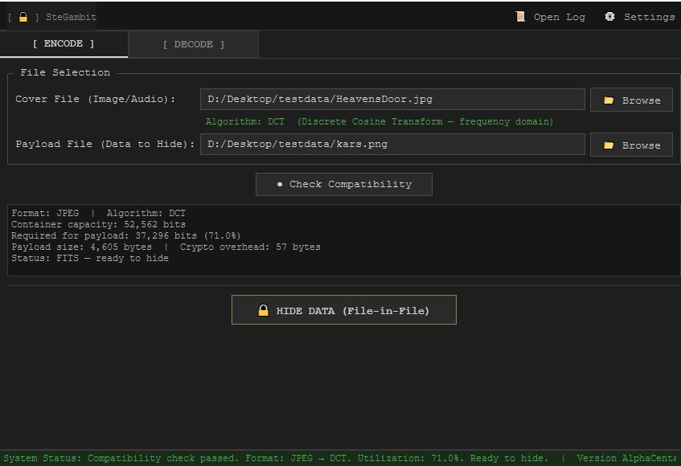

# 🔒 SteGambit


**SteGambit** is a cross-platform tool for securely hiding files inside other files — **"File-in-File" steganography** with cryptographic protection. The project implements advanced embedding algorithms for images (PNG, JPEG) and audio (WAV), with high visual and statistical imperceptibility.

## 🌟 Key features

* **Multi-format support:** `PNG` and `WAV` (spatial/temporal LSB embedding) and `JPEG` (frequency-domain JSteg embedding into DCT coefficients).
* **Content-Aware Spreading (LSB):** A built-in edge detector (Edge Detection) analyzes image gradients and automatically avoids "smooth" regions, embedding the hidden data only in noisy areas to resist visual attacks.
* **Strict cryptography (AEAD):** Before embedding, every file is encrypted with **AES-GCM-256**. Keys are derived from the password with **PBKDF2 (SHA-256)** and a unique salt.
* **Deterministic chaos (PRNG):** Embedding coordinates are shuffled pseudo-randomly. The generator seed is a cryptographic hash of the password, so extraction (or even detection) is impossible without the original secret phrase.
* **Built-in analytics:** Automatic quality metrics: **PSNR**, **SSIM** (optional), and the percentage deviation of the file size.

---

## 📸 Interface // User Guide

SteGambit is designed around the principle "Complex on the inside — simple on the outside". The main window gives quick access to encoding and decoding.

### 1. Compatibility check and hiding (ENCODE PANEL)

1. Select the carrier file (**Carrier File**).
2. Select the file to hide (**Payload File**).
3. Click `Check Compatibility`. The core mathematically estimates the carrier capacity: for PNG it counts edge pixels; for JPEG it checks for usable mid-frequency AC coefficients.
4. If the status is `FITS`, click `HIDE DATA`.
5. In the dialog that opens, enter a password and choose the save path.


### 2. Data extraction (DECODE PANEL)

1. Select the infected (stego) file.
2. Specify the output folder.
3. Enter the password used for embedding.
4. Click `Extract Data`. The system checks the Magic Bytes of the encrypted frame and the integrity of the AES-GCM authentication tag (MAC), then restores the original file with its original extension.

### 3. Configuration and quality metrics
In the `⚙ Settings` menu you can turn off heavy visual metrics (SSIM) to speed up processing, or control the logging level. After each embedding the `AnalyticsAnalyzer` panel is shown:


---

## 🛠 Technical architecture (Under the Hood)

SteGambit follows **Clean Architecture**, with a clear boundary between layers:

```text
┌─────────────────────────────────────────────────────────┐
│                    GUI Layer (PyQt6)                    │
│  MainWindow → EncodePanel / DecodePanel / SettingsDlg   │
└─────────────────────────────────────────────────────────┘
                             │
                             │ StegoTaskRequest (DTO)
                             ▼
┌─────────────────────────────────────────────────────────┐
│                  Async Layer (QThread)                  │
│  StegoWorker — isolates heavy work from the UI thread   │
└─────────────────────────────────────────────────────────┘
                             │
                             ▼
┌─────────────────────────────────────────────────────────┐
│                 Service Layer (Facade)                  │
│ StegoService — orchestration: validate → crypto →       │
│ spread → embed → save → metrics                         │
└─────────────────────────────────────────────────────────┘
                             │
       ┌─────────────────────┼─────────────────────┐
       ▼                     ▼                     ▼
┌──────────────┐     ┌──────────────┐     ┌──────────────┐
│ CryptoEngine │     │   Spreader   │     │  Processor   │
│ (AES-GCM-256)│     │ (Smart/DCT)  │     │  (LSB/DCT)   │
└──────────────┘     └──────────────┘     └──────────────┘
       │                     │                     │
       └─────────────────────┼─────────────────────┘
                             ▼
                     ┌──────────────┐
                     │  Format I/O  │
                     │ PNG/WAV/JPEG │
                     └──────────────┘
```

The GUI **knows nothing** about `numpy`, `AES`, or `DCT coefficients`. The service layer **knows nothing** about `QtWidgets`. They communicate through DTOs (`StegoTaskRequest` / `StegoResponse`).

### Cryptographic frame

Before embedding, the payload is wrapped in a `CryptoFrame` — a self-describing binary block:

```text
┌────────┬───────┬──────────┬───────────┬─────────┬──────────────────────┐
│ MAGIC  │ FLAGS │   SALT   │   NONCE   │  LENGTH │      CIPHERTEXT      │
│ 4 byte │ 1 byte│ 16 bytes │  12 bytes │ 8 bytes │      + GCM-TAG       │
└────────┴───────┴──────────┴───────────┴─────────┴──────────────────────┘
  "STGB"   v1.0     random      random    big-end       AES-GCM-256
```

- **MAGIC** — the `STGB` signature. Checked first on extraction: if it does not match, either the password is wrong or the file contains no payload.
- **SALT** — 128 random bits (16 bytes). Fed into PBKDF2 together with the password, so the same password on two different stego files yields **different** AES keys.
- **NONCE** — the IV for AES-GCM (12 bytes, as required by NIST SP 800-38D).
- **LENGTH** — ciphertext length in bytes. Extraction reads exactly that many bits, and no more.
- **CIPHERTEXT + GCM-TAG** — the encrypted payload plus a 16-byte authentication tag. Changing even one bit of the ciphertext raises `InvalidTag` on decrypt — that is the tamper detector.

### LSB Spreading (PNG/WAV)

Naive LSB writes bits into the first N pixels in a row, and a statistical χ²-test detects that in milliseconds. **SmartSpreader** does three things:

1. **Edge detection** — the Sobel operator on the grayscale projection; smooth regions are discarded (that is where LSB noise is visible to the eye).
2. **Pool pruning** — candidates are filtered down to pixels with a high gradient.
3. **Password-seeded shuffle** — the pool is shuffled with a permutation seeded from `SHA-256(password)`. Without the password the coordinates cannot be recovered.

The payload ends up scattered across the "noisy" zones of the carrier, in an order that is deterministic but cryptographically unpredictable.

### DCT Spreading (JPEG)

For JPEG, spatial pixels are useless: recompression would destroy the changes. **DctProcessor** works on the **quantized DCT coefficients** directly (no re-encode):

1. `jpegio` extracts `coef_arrays[0]`, the Y channel of the 8×8 blocks.
2. Each block contributes **mid-frequency AC** coefficients (zigzag 1..27). DC is left untouched (changing it causes "checkerboard" artifacts). High frequencies are almost always zero, and modifying them would break Huffman compression.
3. The values `{-2, -1, 0, 1}` are excluded from the pool. An LSB change there either flips the sign (which breaks the decoder) or zeroes the coefficient (which breaks the pool on extraction).
4. The permutation is the same `password-seeded shuffle`.

The result is a JSteg-like pipeline with an extended filter, robust to re-save in most viewers.

### Performance

- **NumPy vectorization:** every bitwise operation (`unpackbits` / `packbits` / masks `& ~1 | bit`) runs on whole arrays, with no Python loops.
- **Async UI:** heavy work goes to `StegoWorker(QThread)`, so the GUI stays responsive even on a 68 MB WAV.
- **Optional SSIM:** the psychovisual metric can be turned off in settings (saves ~1.5 s on a 2 MB PNG).

Detailed UML/C4 diagrams and Architectural Decision Records (ADR) are in the `docs/` folder.


---

## ⚙️ Build and installation (Build & Run)

### Requirements

- **Python 3.12+**
- **OS:** Windows 10/11, macOS 12+, Linux (Ubuntu 22.04+)
- ~500 MB of free disk space (including the venv and dependencies)

### Option 1 — Use a prebuilt .exe (for Windows users)

Download the latest release from the repository **Releases** section. The archive contains:

```text
SteGambit/
├── SteGambit.exe  ← executable
├── _internal/     ← runtime dependencies
└── README.txt
```

Launch `SteGambit.exe` — installation is not required. Settings stay in application memory (they are not written to the Windows registry).

### Option 2 — Run from source (for developers)

```bash
# 1. Clone the repository
git clone https://git.cs.hse.ru/dddaragan/SteGambit.git
cd SteGambit

# 2. Create a virtual environment
python -m venv .venv
.\.venv\Scripts\activate         # Windows
source .venv/bin/activate        # macOS/Linux

# 3. Install dependencies
pip install -e .                 # from pyproject.toml
# or
pip install -r requirements.txt  # from requirements

# 4. Run the application
python -m stegambit
```

### Option 3 — Build an .exe from source (PyInstaller)

```bash
# Install PyInstaller
pip install pyinstaller

# Build (onedir mode, recommended — starts faster)
pyinstaller build.spec

# Output:
# dist/SteGambit/SteGambit.exe
```

The PyInstaller configuration is in `build.spec`. Parameters:

- **onedir** — the application and its runtime in a separate folder (fast startup, ~100 MB).
- **windowed** — no black console when the GUI starts.
- **hidden imports** — `jpegio` and `PIL._tkinter_finder` are listed explicitly (PyInstaller does not always find them on its own).

### Running tests

```bash
# Unit + integration (fast, ~30 seconds):
pytest tests/

# E2E smoke test (fast):
pytest tests/e2e/

# E2E load (heavy scenarios, ~3-6 minutes):
pytest tests/e2e/test_e2e_load.py -m load -v -s
```

### API documentation

```bash
# Install mkdocs (once)
pip install mkdocs mkdocstrings[python]

# Start the local server
mkdocs serve
# → opens http://127.0.0.1:8000 with auto-generated API documentation
```

---

## ❓ FAQ and limitations (Troubleshooting)

**Q: The error "Insufficient capacity / TOO LARGE" appears, even though the original file is 5 MB and the payload is 1 MB.**
A: File size in bytes is not the same as steganographic capacity. For `JPEG`, capacity is limited by the number of non-zero valid DCT coefficients. For `PNG`, capacity is limited by the *Content-Aware* policy (the system will not damage smooth regions such as sky or walls, because that would create visual artifacts). Use a detailed (noisy) picture, or increase the resolution.

**Q: Extraction fails with "MAGIC bytes not found".**
A: One of two things is true: (1) the password is wrong (the coordinates were generated incorrectly and the system read "garbage"), or (2) the file is clean and contains no hidden data.

**Q: Why can't I hide data in a `PNG` and save the result as `JPEG`?**
A: A mathematical *anti-conversion policy* is enabled. Saving an LSB-modified image to a lossy format (JPEG) recompresses the spatial matrix, and Huffman coding plus quantization destroy the least significant bits. The interface blocks that action.

---
*Created as an Academic Project.
